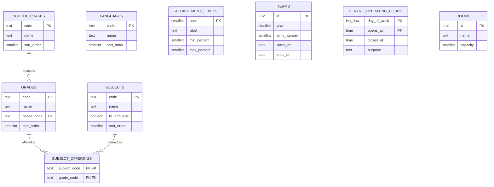
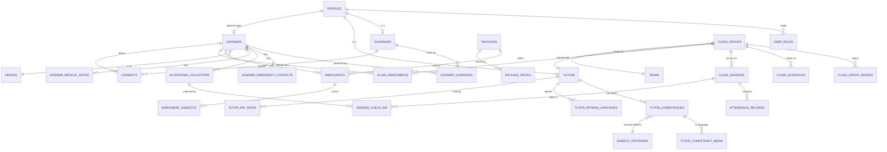
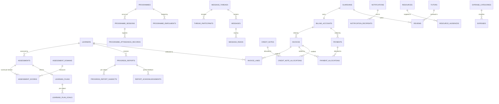

# Entity relationship diagram

Built incrementally. Phase 0 covers reference and curriculum only.

## Phase 0 — reference and curriculum

`LANGUAGES`, `ACHIEVEMENT_LEVELS`, `TERMS`, `CENTRE_OPERATING_HOURS` and `ROOMS` stand alone in Phase 0; they gain relationships in Phase 1.

### Notes

- **`GRADES.phase_code`** is the only place the grade→phase fact lives. Storing phase on a learner would be a transitive dependency (learner → grade → phase) and break 3NF.
- **`SUBJECT_OFFERINGS`** is a genuine binary relation, not a decomposition. Subject and grade are not independent: the centre offers Accounting only at FET and Reading only at Foundation.
- **`CENTRE_OPERATING_HOURS`** is keyed on day *plus* opening time, so a day can have more than one block.
- **`TERMS`** and **`ROOMS`** ship empty by design — see the README.

## Phase 1 — people, enrolment, timetable

### Notes

- **`TUTOR_COMPETENCIES` → `SUBJECT_OFFERINGS`** is a composite FK on `(subject_code, grade_code)`. A tutor cannot be competent in something the centre does not offer at that grade.
- **`CLASS_GROUPS.language_code`** is the medium of instruction. A trigger requires the assigned tutor to hold a matching competency *and* medium, at every grade the class covers.
- **`CLASS_SESSIONS.meeting_url`** is per occurrence. `class_sessions` is not publicly readable; the published timetable is the `v_public_timetable` view, which omits the link.
- **`CONSENTS`** gates enrolment activation by trigger (POPIA s35).

## Phase 2 — assessment, billing, communication

### Notes

- **`PAYMENT_ALLOCATIONS`** is the many-to-many the old schema could not express. One EFT settles several invoices; one invoice takes several payments.
- **`INVOICE_LINES.learner_id`** attributes each line to a child, so one household invoice still breaks down per learner.
- **Payment state is derived** in `v_invoice_status`, never stored on `invoices`.
- **`ASSESSMENT_SCORES`** is one row per domain, which is what makes `v_assessment_improvement` possible.
- **`MESSAGE_READS`** and **`NOTIFICATION_RECIPIENTS`** carry read state per person, which a single `read_at` column cannot.
