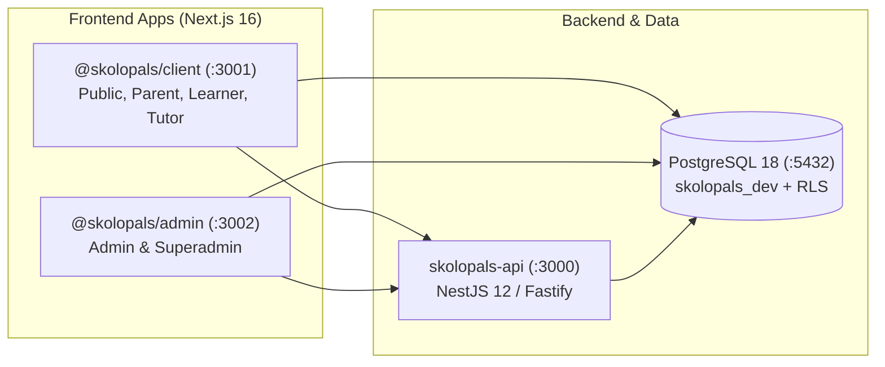
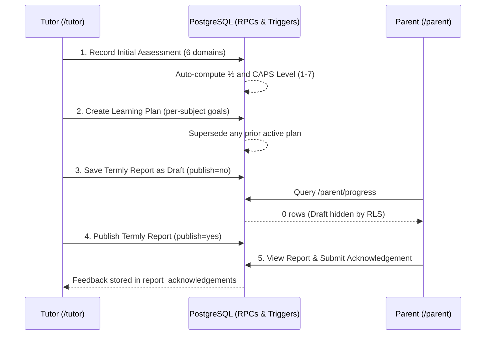

# Skolopals Platform — End-to-End (E2E) Test Case Document

| Metadata | Details |
| :--- | :--- |
| **System** | Skolopals Tutoring Centre Platform (`db`, `api`, `apps/client`, `apps/admin`) |
| **Curriculum & Locale** | South African CAPS (Grade R–12) · Currency: `ZAR` (cents) · Timezone: `Africa/Johannesburg` |
| **References** | [BRS-skolopals-2026.md](file:///Users/mollomponya/Documents/Dev/skoloplas/skolopals/docs/BRS-skolopals-2026.md) · [SPEC-2026-centre-rebuild.md](file:///Users/mollomponya/Documents/Dev/skoloplas/skolopals/docs/SPEC-2026-centre-rebuild.md) · [00-overview.md](file:///Users/mollomponya/Documents/Dev/skoloplas/skolopals/docs/client-admin-split-plan/00-overview.md) |

---

## 1. Architecture & Test Environment Setup



### 1.1 Pre-Flight Setup Commands

Run these steps from a terminal before executing the manual or automated test suites:

1. **Rebuild and verify the local PostgreSQL database:**
   ```bash
   cd /Users/mollomponya/Documents/Dev/skoloplas/skolopals/db
   make reset
   ```
   *Expected result:* Creates `skolopals_dev`, applies the local Supabase shim ([00_roles.sql](file:///Users/mollomponya/Documents/Dev/skoloplas/skolopals/db/local/00_roles.sql), [01_supabase_shim.sql](file:///Users/mollomponya/Documents/Dev/skoloplas/skolopals/db/local/01_supabase_shim.sql), [02_dev_helpers.sql](file:///Users/mollomponya/Documents/Dev/skoloplas/skolopals/db/local/02_dev_helpers.sql)), runs all migrations in [migrations/](file:///Users/mollomponya/Documents/Dev/skoloplas/skolopals/db/migrations), loads reference seeds in [seed/](file:///Users/mollomponya/Documents/Dev/skoloplas/skolopals/db/seed), and passes all 7 database test suites.

2. **Start the full application stack:**
   ```bash
   cd /Users/mollomponya/Documents/Dev/skoloplas/skolopals
   pnpm install
   pnpm dev
   ```
   *Expected ports:*
   - **NestJS API (`skolopals-api`):** `http://localhost:3000` (or `PORT` in `api/.env`)
   - **Client Web App (`@skolopals/client`):** `http://localhost:3001`
   - **Admin Web App (`@skolopals/admin`):** `http://localhost:3002`

### 1.2 Test Personas & Role Matrix

| Persona | Role Code | Portal | Primary Access Scope |
| :--- | :--- | :--- | :--- |
| **Visitor** | `anon` | Client (`:3001`) | Public pages, published tutors, packages, published timetable (no `meeting_url`), enquiry form submission. |
| **Parent / Guardian** | `parent` | Client (`:3001/parent`) | Own children only: enrolments, timetable, attendance, assessments, published reports, invoices, statements, messages. |
| **Learner** | `learner` | Client (`:3001/learner`) | Self only (if issued login): own timetable, own progress reports, resources, messages. No billing or sibling data. |
| **Tutor** | `tutor` | Client (`:3001/tutor`) | Assigned classes & learners only: schedule, attendance register, assessments, learning plans, reports, sessions taught. **Denied all billing and medical notes.** |
| **Administrator** | `admin` | Admin (`:3002/admin`) | Centre operations: user invites (non-admin roles), enrolment queue, tutors, timetable, billing, expenses, enquiries, announcements, KPIs. |
| **Super Administrator** | `superadmin` | Admin (`:3002/admin`) | All `admin` capabilities **plus** the ability to invite/assign `admin` accounts. |

> [!TIP]
> **Local SQL Role Impersonation:** When testing directly in `make psql`, use the helpers in [02_dev_helpers.sql](file:///Users/mollomponya/Documents/Dev/skoloplas/skolopals/db/local/02_dev_helpers.sql):
> ```sql
> select dev.login_as('<user-uuid>'); -- Impersonate an authenticated user
> select dev.login_anon();            -- Impersonate an anonymous visitor
> select dev.logout();                -- Return to superuser
> ```

---

## 2. Suite 1: Automated Database, Monorepo & Smoke Verification

Run these automated suites first to establish a clean baseline before manual UI testing.

| Test ID | Test Case | Command / Steps | Expected Result |
| :--- | :--- | :--- | :--- |
| **TC-AUTO-01** | Schema, 4NF & Structural Integrity | `cd db && make verify` ([verify.sh](file:///Users/mollomponya/Documents/Dev/skoloplas/skolopals/db/scripts/verify.sh)) | All structural checks pass: 9 reference tables exist, **0 `ARRAY` columns** in `public` (4NF rule), every table has a PK and RLS enabled, every view except `v_public_timetable` has `security_invoker = true`, 10 packages and 13 CAPS grades seeded, `terms` and `rooms` ship empty. |
| **TC-AUTO-02** | Row-Level Security (RLS) Suite | `cd db && make test-rls` ([test-rls.sh](file:///Users/mollomponya/Documents/Dev/skoloplas/skolopals/db/scripts/test-rls.sh)) | Proves live query isolation across Guardian A, Guardian B, Tutor, Learner, Anon, Admin, and Superadmin. Transaction rolls back cleanly. |
| **TC-AUTO-03** | Business Rule Triggers Suite | `cd db && make test-rules` ([test-rules.sh](file:///Users/mollomponya/Documents/Dev/skoloplas/skolopals/db/scripts/test-rules.sh)) | Proves DB rejects invalid tutor competency/medium/grade, out-of-hours schedules, unconsented enrolments, exceeded subject allowances, exceeded class/programme capacities, unauthorised collectors, and overlapping temporal ranges. |
| **TC-AUTO-04** | Enrolment Journey Suite | `cd db && make test-enrolment` ([test-enrolment.sh](file:///Users/mollomponya/Documents/Dev/skoloplas/skolopals/db/scripts/test-enrolment.sh)) | Exercises `submit_enrolment` → `activate_enrolment` → `generate_class_sessions` → `attendance_records` → parent visibility. |
| **TC-AUTO-05** | Tutor & Assessment Cycle Suite | `cd db && make test-assessment` ([test-assessment.sh](file:///Users/mollomponya/Documents/Dev/skoloplas/skolopals/db/scripts/test-assessment.sh)) | Exercises `create_tutor` → `set_tutor_competency` → `set_tutor_pay_rate` → `record_assessment` → `create_learning_plan` → `save_progress_report` (draft vs published) → parent acknowledgement. |
| **TC-AUTO-06** | Billing & SPEC §9.3 Suite | `cd db && make test-billing` ([test-billing.sh](file:///Users/mollomponya/Documents/Dev/skoloplas/skolopals/db/scripts/test-billing.sh)) | Verifies `SKP-YYYY-NNNN` annual sequence reset, R150 registration invoice, R1,900 catch-up invoice, 3-day grace period, single payment settling 3 invoices across 2 children, and over-allocation rejection. |
| **TC-AUTO-07** | Month-Close & Surplus Suite | `cd db && make test-month-close` ([test-month-close.sh](file:///Users/mollomponya/Documents/Dev/skoloplas/skolopals/db/scripts/test-month-close.sh)) | Exercises `run_monthly_invoices`, idempotency on re-run, `record_payment` (full & partial oldest-first), `apply_late_fees` onto a new invoice, and `v_operating_surplus`. |
| **TC-AUTO-08** | Monorepo Lint, Typecheck, Unit Test & Build | From repo root: `pnpm turbo run lint typecheck test build` | `packages/shared`, `packages/ui`, `api`, `apps/client`, and `apps/admin` all pass linting, strict TypeScript checks, unit tests, and production builds with zero errors. |
| **TC-AUTO-09** | Playwright Post-Deploy Smoke Checks | 1. `node apps/client/scripts/smoke.mjs http://localhost:3001`<br/>2. `node apps/admin/scripts/smoke.mjs http://localhost:3002` | Client smoke check passes `/`, `/pricing`, `/timetable`, `/privacy`, `/tutors` with 0 console errors. Admin smoke check verifies `/` redirects to `/login` with `"Admin Sign In"` and 0 console errors. |

---

## 3. Suite 2: Public Marketing Website & Anonymous Visitor (`apps/client` on `:3001`)

Test as an unauthenticated visitor in an incognito browser window at `http://localhost:3001`.

| Test ID | Route | Steps to Execute | Expected Result | BRS Ref |
| :--- | :--- | :--- | :--- | :--- |
| **TC-PUB-01** | `/` (Home) | 1. Navigate to `http://localhost:3001/`.<br/>2. Inspect header, hero copy, CAPS phases, value chain, and footer. | Displays Damonsville / Brits community centre branding, tagline *"Learning Today. Succeeding Tomorrow."*, CAPS phases (Foundation, Intermediate, Senior, FET), and the 7-step value chain (Assessment → Learning Plan → Tutoring → Homework → Testing → Progress Report → Parent Feedback). No legacy marketplace copy (`Become a Tutor` or USD pricing). | BR-62 |
| **TC-PUB-02** | `/subjects` | 1. Click **Subjects** in the top navigation.<br/>2. Inspect subjects grouped by CAPS phase. | Shows Foundation (Grade R–3), Intermediate (Grade 4–6), Senior (Grade 7–9), and FET (Grade 10–12) subjects matching CAPS offerings (e.g., Reading/Writing in Foundation; Accounting, Business Studies, Economics, Physical Sciences, Life Sciences, Mathematical Literacy only in FET). | BR-17, BR-18, BR-64 |
| **TC-PUB-03** | `/pricing` | 1. Click **Fees** (`/pricing`).<br/>2. Verify all package tiers and prices. | Displays all 10 seeded packages in **ZAR (`R`)**:<br/>• Group – 1 subject: **R450/month**<br/>• Group – 2 subjects: **R750/month**<br/>• Group – 3 subjects: **R950/month**<br/>• All-subject support: **R1,100/month**<br/>• Homework assistance: **R500/month**<br/>• Academic Plus: **R1,250/month**<br/>• One-on-one (1 hr): **R180** · (4 lessons): **R650**<br/>• Registration fee: **R150 once-off**<br/>• Holiday programme: **R350–R750**<br/>No sibling/multi-subject discount promise is shown. | BR-12, BR-15, BR-51, BR-63 |
| **TC-PUB-04** | `/tutors` & `/tutors/[slug]` | 1. Click **Our Tutors** (`/tutors`).<br/>2. Filter by subject, grade, or language.<br/>3. Click a tutor card to open `/tutors/[slug]`.<br/>4. Click **Request this tutor**. | Staff directory displays active tutors with photo, headline, subjects, grades, languages, rating, and published reviews. **No hourly rate or price filter is shown.** Clicking "Request this tutor" links to `/enrol?tutor=<slug>`. | BR-23, BR-24, BR-25 |
| **TC-PUB-05** | `/timetable` & `/programmes` | 1. Click **Timetable** (`/timetable`).<br/>2. Check operating hours and scheduled classes.<br/>3. Click **Holiday Programmes** (`/programmes`). | `/timetable` shows Centre Operating Hours (Mon–Thu 13:00–18:00, Fri Admin/Assessments, Sat 08:00–13:00, Sun Closed) and class groups from `v_public_timetable` **without exposing any online `meeting_url`**. `/programmes` displays published Saturday/Holiday programmes with dates and ZAR prices. | BR-28, BR-30, BR-65, BR-66 |
| **TC-PUB-06** | `/privacy`, `/about`, `/safeguarding`, `/terms` | 1. Click footer links for **Privacy**, **About**, **Keeping learners safe**, and **Terms**. | `/privacy` renders the South African POPIA privacy notice (Part A of `POPIA-policy.md`, s35 children's data consent, s72 cross-border transfer notice). `/safeguarding` explains sign-in/sign-out and controlled collection. | BR-67, OBJ-8 |
| **TC-PUB-07** | `/contact` | 1. Navigate to `/contact`.<br/>2. Fill in Full Name (`"Kgomotso Mokoena"`), Email/Phone, Source (`"WhatsApp"`), and Message (`"Enquiring about Grade 10 Maths"`).<br/>3. Submit the form. | Submission succeeds and inserts a `new` row in `public.contact_enquiries`. Verify that anonymous visitors cannot read back existing enquiries (`SELECT` denied by RLS). | BR-55 |

---

## 4. Suite 3: Authentication, Portal Isolation & User Management

Tests the strict separation between `apps/client` (`:3001`) and `apps/admin` (`:3002`), as well as the `admin` vs `superadmin` role hierarchy introduced in [20261113000002_user_invites_and_superadmin_rls.sql](file:///Users/mollomponya/Documents/Dev/skoloplas/skolopals/db/migrations/20261113000002_user_invites_and_superadmin_rls.sql).

| Test ID | Scenario | Steps to Execute | Expected Result |
| :--- | :--- | :--- | :--- |
| **TC-AUTH-01** | Parent Self-Registration (`apps/client`) | 1. Go to `http://localhost:3001/signup`.<br/>2. Enter Full Name (`"Thandi Mokoena"`), Phone (`"0821234567"`), Email (`"thandi@test.local"`), and Password.<br/>3. Submit form (and complete email confirmation if using GoTrue, or inspect `auth.users` locally). | Trigger `private.handle_new_user()` automatically:<br/>1. Splits `full_name` into `first_name` (`"Thabo"`/`"Thandi"`) and `last_name` (`"Mokoena"`) on `public.profiles`.<br/>2. Grants role `'parent'` in `public.user_roles`.<br/>3. Creates a row in `public.guardians`.<br/>4. Redirects user to `/parent`. |
| **TC-AUTH-02** | Admin Portal Rejects Non-Admin Accounts | 1. Go to `http://localhost:3002/login` (Admin Portal).<br/>2. Confirm there is **no Sign Up link**.<br/>3. Attempt to sign in with a `parent`, `tutor`, or `learner` account. | Login is rejected immediately; the session is signed out and the form displays: `"Access denied. This portal is restricted to administrators."` |
| **TC-AUTH-03** | Client Portal Blocks Admin-Only Accounts & Has No `/admin` Routes | 1. Visit `http://localhost:3001/admin` on the Client App.<br/>2. Attempt to sign in on `http://localhost:3001/login` using an account that *only* holds the `admin` role. | 1. `http://localhost:3001/admin` returns `404 Not Found` (no admin code shipped in `apps/client`).<br/>2. Admin-only sign-in on `apps/client` does not redirect to `/admin`; it instructs the user to use the Admin Portal. |
| **TC-AUTH-04** | Client Role Workspace Gate (`proxy.ts` & `requireClientRole`) | 1. Signed in as a `parent` on `:3001`, navigate to `/tutor` or `/learner`.<br/>2. Signed in as a `tutor` on `:3001`, navigate to `/parent`. | Automatically redirected back to `clientHomeFor(roles)` (`/parent` for parent, `/tutor` for tutor, `/learner` for learner). |
| **TC-AUTH-05** | Admin Invites Tutor (`configure_invited_user`) | 1. Sign in to `http://localhost:3002/login` as a regular `admin`.<br/>2. Navigate to **Users** (`/admin/users`).<br/>3. Inspect the **Role** dropdown in the "Add a user" form.<br/>4. Invite First Name `"Naledi"`, Last Name `"Dube"`, Email `"naledi.dube@test.local"`, Role `"Tutor"`. | 1. Role dropdown for a regular `admin` contains **only** `Parent / guardian`, `Tutor`, and `Learner` (does **not** include `Admin` or `Super administrator`).<br/>2. Submitting creates the user, replaces the default `parent` role with `tutor`, removes the unused `guardians` row, and **automatically creates an `active`, `sessional` row in `public.tutors` with slug `naledi-dube`**. |
| **TC-AUTH-06** | Regular Admin Cannot Create Another Admin | 1. As a regular `admin`, attempt to call `public.configure_invited_user(<uuid>, 'Lerato', 'Nkosi', 'admin')` or `INSERT INTO public.user_roles VALUES (<uuid>, 'admin')`. | Rejected by database RPC check (`"Only super administrators can create administrator accounts"`) and by `user_roles` RLS policy (`insufficient_privilege`). |
| **TC-AUTH-07** | Superadmin Can Create Admin, Cannot Escalate to Superadmin | 1. Sign in to `http://localhost:3002` as a `superadmin`.<br/>2. Verify sidebar subtitle reads `"Super Administrator"`.<br/>3. Open `/admin/users` and check the **Role** dropdown.<br/>4. Invite a new user with Role `"Admin"`.<br/>5. Attempt to assign `'superadmin'` via API/SQL (`configure_invited_user(..., 'superadmin')`). | 1. Role dropdown includes `"Admin"`.<br/>2. Inviting an `"Admin"` succeeds and grants `'admin'` in `public.user_roles`.<br/>3. Attempting to assign `'superadmin'` via application writes or RPC is rejected (`"Super administrator role cannot be assigned"`). |

---

## 5. Suite 4: Tutor Administration & Timetable Builder (`apps/admin` on `:3002`)

Log in to `http://localhost:3002/admin` as an `admin` or `superadmin`.

| Test ID | Feature / Route | Steps to Execute | Expected Result | BRS Ref |
| :--- | :--- | :--- | :--- | :--- |
| **TC-ADM-01** | Tutor Creation & Profile (`/admin/tutors`) | 1. Go to `/admin/tutors`.<br/>2. If a user signed up directly (or was invited), add/view them in the Tutors list.<br/>3. Click a tutor's name to open `/admin/tutors/[id]`.<br/>4. Attempt to create a duplicate tutor for the same email or an email without an account. | Tutor appears in `/admin/tutors`. Duplicate tutor creation or unknown email is rejected with a clear error message. | BR-23 |
| **TC-ADM-02** | Tutor Competencies: Subject × Grade × Medium (`/admin/tutors/[id]`) | 1. On `/admin/tutors/[id]`, under **Add what they teach**:<br/>   • Add `Mathematics` + `Grade 7` + `English`.<br/>   • Add `English` + `Grade 7` + `English` & `Afrikaans`.<br/>2. Attempt to add a competency with **no language checked**.<br/>3. Via SQL/API, attempt to add `Accounting` at `Grade 4`. | 1. Competencies are saved in `tutor_competencies` and `tutor_competency_media`.<br/>2. Re-adding an existing `(subject, grade)` replaces its languages rather than duplicating.<br/>3. Empty language list is rejected.<br/>4. `Accounting` at `Grade 4` is rejected by composite FK to `subject_offerings` (FET-only subject). | BR-19, BR-20, DR-02 |
| **TC-ADM-03** | Tutor Spoken Languages & Non-Overlapping Pay Rates (`/admin/tutors/[id]`) | 1. Under **Languages they speak**, check `English` and `Setswana` and click **Save languages**.<br/>2. Under **Set a pay rate**, set `Per hour`, `R120`, effective `2026-01-01`.<br/>3. Set a second pay rate: `Per hour`, `R140`, effective `2026-07-01`. | 1. Spoken languages are saved in `tutor_spoken_languages` independently of teaching media.<br/>2. Adding the `2026-07-01` pay rate automatically closes the `2026-01-01` rate (`effective_to = '2026-07-01'`), leaving exactly one open rate and preventing temporal overlap. | BR-21, BR-26, DR-03 |
| **TC-ADM-04** | School Terms & Rooms Setup (`/admin/timetable`) | 1. Navigate to `/admin/timetable`.<br/>2. In **Add a term**, enter Year `2026`, `Term 4`, Starts `2026-10-06`, Ends `2026-11-03` and click **Add term**.<br/>3. Attempt to add another term with overlapping dates (`2026-10-20` to `2026-11-15`).<br/>4. In **Add a room**, enter Name `"Main Room"`, Capacity `6` and click **Add room**. | 1. Term 4 (2026) is created.<br/>2. Overlapping term is rejected by exclusion constraint.<br/>3. `"Main Room"` (capacity 6) is created. | BRS D-01, BR-27 |
| **TC-ADM-05** | Class Group Creation — Competency & Operating Hours Validation (`/admin/timetable`) | 1. In **Add a class**, attempt to create a class where the tutor is **not** competent in the chosen subject, grade, or medium (e.g., Grade 7 Maths in `Afrikaans` when the tutor only teaches Maths in `English`, or Grade 9 Maths).<br/>2. Attempt to schedule a class outside operating hours (e.g., Tuesday `09:00–10:00` or Sunday).<br/>3. Attempt to create an `At the centre` (`in_centre`) class without selecting a Room. | All three invalid attempts are rejected by database constraints/triggers:<br/>• Tutor must hold matching `tutor_competency` + `tutor_competency_media` for every grade covered.<br/>• Schedule must fall within `centre_operating_hours` (Mon–Thu 13:00–18:00, Sat 08:00–13:00).<br/>• `in_centre` classes require a `room_id`. | BR-20, BR-27, BR-28 |
| **TC-ADM-06** | Valid Class Creation & Idempotent Session Generation (`/admin/timetable`) | 1. Create class `"Grade 7 Mathematics (English)"`, Subject `Mathematics`, Taught in `English`, Grade `Grade 7`, Tutor `Naledi Dube`, Term `2026 Term 4 (2026-10-06 to 2026-11-03)`, Delivery `At the centre`, Room `Main Room`, Capacity `6`, Meets on `Tue` and `Thu`, From `15:00` To `16:00`.<br/>2. Click **Create class and generate sessions**.<br/>3. Click **Regenerate sessions** on the created class card. | 1. Class group is created and `generate_class_sessions` materialises **9 sessions** across the term (5 Tuesdays + 4 Thursdays between 6 Oct and 3 Nov 2026) at `15:00 SAST`.<br/>2. Clicking **Regenerate sessions** is idempotent — session count remains 9 with no duplicates. | BR-27, BR-33 |
| **TC-ADM-07** | Tutor applications switch (`/admin/tutor-applications`) | 1. Click **Open applications**, set a closing date, tick `Mathematics` as needed, leave **Require a police clearance certificate** off.<br/>2. Open the client home page (`:3000/`) within a minute.<br/>3. Back in admin, click **Close now** and reload the home page after a minute. | 1. The Recruitment card shows Open with the closing date.<br/>2. The hero shows **Apply to teach** and a "We're looking for tutors" banner lists Mathematics.<br/>3. Both disappear; `/teach` says applications are closed. | BR-23a |
| **TC-ADM-08** | Apply to teach, signed out → signed up (`/teach`) | 1. With applications open, sign out and open `/teach`; click **Create an account**.<br/>2. Sign up and click the email link.<br/>3. Complete all 7 steps: switch **My WhatsApp number is the same** off and enter one; pick Mathematics Grades 6–7 in English; upload a CV, a qualification, an ID photo; on a phone, tap **Selfie** (front camera opens); add three references.<br/>4. Try a PDF as the selfie; try two references with the same phone; try sending without ticking the three statements. | 1–2. The confirmation link lands back on `/teach`, signed in, with the form.<br/>3. **Send application** shows "Application sent"; reloading `/teach` shows the status card "Received". Admin sees it under **Needs action** with a nav badge.<br/>4. Each is refused with a clear message. | BR-23, BR-23b |
| **TC-ADM-09** | Review, identity, police clearance, approve (`/admin/tutor-applications/[id]`) | 1. Open the application: ID and selfie appear side by side. Click **Mark identity checked**.<br/>2. Click **Request police clearance** with a message.<br/>3. As the applicant, open `/teach` and upload a certificate from the request card.<br/>4. As admin, **Approve**.<br/>5. As the applicant, sign out and in again. | 2–3. The applicant gets a notification and an upload card; after uploading, admin sees "Received" and is notified.<br/>4. Lands on `/admin/tutors/[id]` with status **suspended**, the competencies, 5–6 documents (ID and selfie verified), 3 unchecked references and an **Open application** link. The tutor is not in the public directory.<br/>5. They land in the tutor portal; they cannot activate themselves. | BR-22, BR-23b |
| **TC-ADM-10** | Police clearance required by the round | 1. Edit the open round: turn **Require a police clearance certificate** on.<br/>2. As a new applicant, reach the Identity step. | The certificate upload is shown and **Next** is refused without it. Applications submitted before the change still show "Not required for this round". | BR-23a |

---

## 6. Suite 5: Parent Enrolment, POPIA Consent Gating & Admin Approval

Tests the end-to-end enrolment flow across `apps/client` (`:3001/enrol`) and `apps/admin` (`:3002/admin/enrolments`).

| Test ID | Feature / Route | Steps to Execute | Expected Result | BRS Ref |
| :--- | :--- | :--- | :--- | :--- |
| **TC-ENR-01** | Unauthenticated Enrolment Gate (`/enrol`) | 1. In an incognito window (logged out), navigate to `http://localhost:3001/enrol`. | Enrolment form is not shown; user sees `"Create an account to continue"` with buttons for `/signup` and `/login?next=/enrol` (POPIA requirement to identify the consenting guardian). | BR-09, OBJ-8 |
| **TC-ENR-02** | Subject Allowance & POPIA Consent Validation (`/enrol`) | 1. Sign in as Parent (`thandi@test.local`) on `http://localhost:3001/enrol`.<br/>2. Select **Group – 2 subjects (R750/month)**.<br/>3. Under **3. Subjects**, select `Mathematics` (`Taught in English`) and `English` (`Taught in English`).<br/>4. Observe the remaining subject checkboxes.<br/>5. Verify the state of Required vs Optional consent checkboxes under **6. Your permission**. | 1. Once 2 subjects are ticked on a 2-subject package, all other subject checkboxes are disabled (`atLimit`).<br/>2. The 3 **Required** POPIA consents (`child_processing`, `special_personal_info`, `cross_border_transfer`) have `required` enforced.<br/>3. The 2 **Optional** consents (`marketing`, `photos`) default to **unchecked** and are not required. | BR-11, AC-13 |
| **TC-ENR-03** | Submit Valid Enrolment Request (`/enrol`) | Complete the form on `/enrol`:<br/>• Package: `Group – 2 subjects`<br/>• Child Full Name: `"Thabo Mokoena"`, DOB: `2013-04-02`, Grade: `Grade 7`, School: `"Damonsville Primary"`, Home language: `Setswana`, Relationship: `Mother`<br/>• Subjects: `Mathematics (English)`, `English (English)`<br/>• Preferred tutor: `Naledi Dube`<br/>• Emergency contact: `"Aunt Palesa"`, `"Aunt"`, `"0721234567"`<br/>• Authorised collector: `"Aunt Palesa"`, `"Aunt"`, `"0721234567"`, Last 4 ID digits: `"4821"`<br/>• Tick all 3 Required consents (leave Optional unchecked).<br/>• Click **Submit enrolment**. | 1. Submission succeeds (`public.submit_enrolment`).<br/>2. Creates learner `"Thabo Mokoena"` with status `'prospective'`.<br/>3. Creates enrolment with status `'pending'` and `preferred_tutor_id` set.<br/>4. Records 2 `enrolment_subjects`, 1 `learner_emergency_contacts`, 1 `authorised_collectors` (`id_number_last4 = '4821'`), and 3 granted `consents` with policy version `'1.0'`. | AC-01, BR-05..BR-11 |
| **TC-ENR-04** | Admin Approves & Activates Enrolment (`/admin/enrolments`) | 1. Log in to Admin Portal (`http://localhost:3002/admin/enrolments`).<br/>2. Locate the pending card for `"Thabo Mokoena"` (shows Grade 7, age, Group – 2 subjects · R750/month, Mathematics & English, Preferred tutor badge `Naledi Dube`).<br/>3. Select Assign tutor: `Naledi Dube — requested`.<br/>4. Set Start date: `2026-10-18`.<br/>5. Enter First month fee in Rand: `400` and Reason: `"Joined 18 October, part month"`.<br/>6. Click **Approve and activate**. | 1. Enrolment status transitions to `'active'`; Learner status transitions to `'active'`.<br/>2. `first_month_amount_cents = 40000` (R400) and `first_month_set_by` / `first_month_reason` are recorded.<br/>3. A `billing_accounts` row is opened for the guardian.<br/>4. An immediate registration invoice (`SKP-2026-NNNN`) for **R150 (`15000` cents)** is raised, due on issue (Rule 6b: tuition joins the 15th cycle).<br/>5. Re-activating the same enrolment is rejected and never double-charges registration. | AC-02, AC-03, BR-13, BR-46, BR-47 |
| **TC-ENR-05** | Learner Placement & Class Capacity Enforcement | 1. Place `"Thabo Mokoena"` into `"Grade 7 Mathematics (English)"` (`class_enrolments`).<br/>2. Test class capacity guard: on a class with `capacity = 2` (or programme with `capacity = 2`), place 2 learners, then attempt to place a 3rd active learner. | 1. Thabo is placed in the class and appears on the class register.<br/>2. Placing a 3rd learner into a capacity-2 class or programme is rejected by the database capacity trigger (`check_violation`). | AC-02, BR-27, BR-34 |
| **TC-ENR-06** | Decline Enrolment Flow (`/admin/enrolments`) | 1. Submit a second test enrolment from the Parent portal.<br/>2. In `/admin/enrolments`, click **Decline this enrolment**. | Enrolment status updates to `'ended'`, disappears from the pending queue, and raises **no** registration invoice. | BR-16 |

---

## 7. Suite 6: Attendance Register, Safeguarding & Online Delivery

Tests tutor attendance marking (`apps/client` `:3001/tutor`), parent visibility (`:3001/parent`), and safeguarding rules.

| Test ID | Feature / Route | Steps to Execute | Expected Result | BRS Ref |
| :--- | :--- | :--- | :--- | :--- |
| **TC-ATT-01** | Tutor Schedule & Attendance Register (`/tutor/schedule` & `/tutor/register`) | 1. Log in to `http://localhost:3001/login` as Tutor (`naledi.dube@test.local`).<br/>2. View `/tutor/schedule` to verify upcoming sessions.<br/>3. Open `/tutor/register`.<br/>4. For `"Thabo Mokoena"` in the first session, click **Present**.<br/>5. Change status to **Late**, then verify `Excused` and `Absent` buttons. | 1. Tutor sees only sessions for classes they teach.<br/>2. Clicking **Present** or **Late** records/updates the `attendance_records` row with `marked_by` set to the tutor's user ID and highlights the active status badge. | AC-04, BR-29, NFR-06 |
| **TC-ATT-02** | Parent Timetable & Real-Time Attendance View (`/parent/timetable` & `/parent/attendance`) | 1. Log in to `http://localhost:3001` as Parent (`thandi@test.local`).<br/>2. Open `/parent/timetable` and `/parent/attendance`. | 1. `/parent/timetable` lists all 9 generated term sessions for Thabo.<br/>2. `/parent/attendance` shows the session attendance mark (`Present` / `Late`) recorded by the tutor on the same day. | AC-04, OBJ-6 |
| **TC-ATT-03** | Online Class Per-Session Meeting Link Privacy | 1. Create or update a `class_sessions` row for an `online` or `hybrid` class with `meeting_url = 'https://meet.example.com/skp-session-1'`.<br/>2. Check `/timetable` as an anonymous visitor (`anon`).<br/>3. Check `/parent/timetable` as an enrolled parent vs a non-enrolled parent. | 1. Public `/timetable` (`v_public_timetable`) never exposes `meeting_url`.<br/>2. Enrolled parent sees the meeting link on `/parent/timetable`.<br/>3. Non-enrolled parent cannot see the session or link. | AC-16, BR-30 |
| **TC-ATT-04** | Safeguarding: Controlled Collection (`session_check_ins`) | 1. Record a session sign-out (`public.session_check_ins`) for Thabo with `collected_by` set to Thabo's authorised collector (`"Aunt Palesa"`).<br/>2. Attempt to record a sign-out for a *different* learner (`Learner B`) using Aunt Palesa's `authorised_collectors.id`. | 1. Sign-out with Thabo's own authorised collector succeeds.<br/>2. Sign-out using a collector authorised for a *different* child is rejected by trigger (`check_violation`). | BR-07, BR-32, OBJ-5 |

---

## 8. Suite 7: Academic Value Chain — Assessments, Learning Plans & Progress Reports

Tests the complete BP §12 cycle across the Tutor Workspace (`:3001/tutor`) and Parent Portal (`:3001/parent`).



| Test ID | Feature / Route | Steps to Execute | Expected Result | BRS Ref |
| :--- | :--- | :--- | :--- | :--- |
| **TC-ACAD-01** | Record Initial Assessment Across 6 Domains (`/tutor/assessments`) | 1. Log in as Tutor (`naledi.dube@test.local`) and go to `/tutor/assessments`.<br/>2. In **Record an assessment**, select Learner `"Thabo Mokoena"`, Type `"Initial assessment"`, Date `2026-10-19`, Term `2026 Term 4`.<br/>3. Enter marks:<br/>   • Reading: `22` out of `50` (44% → Level 3)<br/>   • Spelling: `18` out of `40` (45% → Level 3)<br/>   • Comprehension: `15` out of `50` (30% → Level 2)<br/>   • Writing: `28` out of `40` (70% → Level 6)<br/>   • Mathematics: `41` out of `50` (82% → Level 7)<br/>   • Language: `24` out of `50` (48% → Level 3)<br/>4. Add Notes: `"Reads hesitantly; strong number sense."` and click **Record assessment**. | 1. Assessment and all 6 `assessment_scores` rows are saved.<br/>2. Under **Recent assessments**, each domain displays `raw/max · percent% · CAPS Achievement Level label` derived automatically by the database (e.g., `15/50 · 30% · Elementary achievement`, `41/50 · 82% · Outstanding achievement`).<br/>3. Attempting to submit an assessment with 0 domain scores or for a learner the tutor does not teach is rejected. | AC-05, BR-35, BR-36, BR-37 |
| **TC-ACAD-02** | Create & Supersede Individual Learning Plan (`/tutor/assessments`) | 1. On `/tutor/assessments`, in the **Learning plan** form (`PlanForm`), select Learner `"Thabo Mokoena"` and Term `2026 Term 4`.<br/>2. Add per-subject goals:<br/>   • `English`: Goal `"Raise comprehension to grade level"`, Target Level `Level 4`, Target Date `2026-12-09`<br/>   • `Mathematics`: Goal `"Secure fractions and ratios"`, Target Level `Level 6`, Target Date `2026-12-09`<br/>3. Save the plan.<br/>4. Submit a *second* learning plan for Thabo with a revised goal. | 1. First plan is created with `status = 'active'` and appears under **Active learning plans**.<br/>2. Submitting a second plan automatically marks the first plan `status = 'superseded'` (never deleted) and makes the new plan the sole `'active'` plan. | AC-05, BR-38 |
| **TC-ACAD-03** | Draft Termly Progress Report — Hidden from Parent (`/tutor/reports`) | 1. Go to `/tutor/reports`.<br/>2. Select Learner `"Thabo Mokoena"`, Term `2026 Term 4`.<br/>3. Enter Overall summary: `"Thabo has settled well and his confidence is growing."` and Attendance note: `"Attended 9 of 9 sessions."`<br/>4. Check `English` (Level 4, Strengths: `"Reading fluency improved"`, Improve: `"Comprehension"`, Intervention: `"Weekly guided reading"`) and `Mathematics` (Level 6, Strengths: `"Confident with operations"`, Improve: `"Fractions"`, Intervention: `"Targeted worksheets"`).<br/>5. Click **Save draft** (`publish = no`).<br/>6. Log in as Parent (`thandi@test.local`) and open `/parent/progress`. | 1. Report is saved with `published_at = NULL`.<br/>2. On `/parent/progress`, the parent sees `"No reports yet"` — RLS blocks parents from viewing or acknowledging unpublished draft reports. | BR-40, AC-12 |
| **TC-ACAD-04** | Publish Termly Report (`/tutor/reports`) | 1. Return to `/tutor/reports` as Tutor.<br/>2. Submit the report clicking **Publish to parent** (`publish = yes`).<br/>3. Also verify that attempting to publish a report with 0 subjects is rejected. | 1. Re-saving updates the existing `(learner_id, term_id)` report rather than duplicating it.<br/>2. `published_at` and `issued_on` are automatically stamped. | BR-40, NFR-06 |
| **TC-ACAD-05** | Parent Views & Acknowledges Termly Report (`/parent/progress`) | 1. Log in as Parent (`thandi@test.local`) and open `/parent/progress`.<br/>2. Verify the published report card for `"Thabo Mokoena — Term 4 2026"` and its per-subject breakdown.<br/>3. Enter feedback comment: `"Thank you, we will practise reading at home."` and click **Acknowledge report**. | 1. Parent sees the summary, attendance note, and both subject sections (`English` and `Mathematics`).<br/>2. Submitting the acknowledgement records a row in `public.report_acknowledgements` and updates the card to show: `You acknowledged this on <date> — “Thank you, we will practise reading at home.”` | AC-06, BR-41 |
| **TC-ACAD-06** | Monthly Monitoring & Measurable Improvement (`v_assessment_improvement`) | 1. As Tutor on `/tutor/assessments`, record a `"Monthly monitoring"` assessment for Thabo on `2026-11-02` with `Comprehension`: `30` out of `50` (60%).<br/>2. Check `/admin/reports` (or query `public.v_assessment_improvement`). | `v_assessment_improvement` shows Comprehension improved from `30.00%` (initial) to `60.00%` (latest), a **`+30.00` percentage point improvement**. | BR-39, BR-58 |

---

## 9. Suite 8: Billing Cycle, Multi-Child Invoicing, Payments, Late Fees & Statements

Tests the billing rules in SPEC §9 (`SKP-YYYY-NNNN`, 15th issue date, 1st due date, catch-up billing, M:N payment allocations, 3-day grace period, and R150 late fee) via `/admin/billing` and `/parent/account`.

| Test ID | Feature / Route | Steps to Execute | Expected Result | BRS Ref |
| :--- | :--- | :--- | :--- | :--- |
| **TC-BILL-01** | Second Child Enrolment in Same Family | 1. As Parent (`thandi@test.local`), enrol a second child `"Lerato Mokoena"` (Grade 5) on `Group – 1 subject` (R450/month).<br/>2. As Admin (`/admin/enrolments`), approve Lerato starting `2026-11-01` with full package price (leave First month fee blank). | 1. Lerato is linked to the **same** family `billing_account` as Thabo.<br/>2. A second R150 registration invoice is raised on the family account. | BR-01, BR-03, BR-46 |
| **TC-BILL-02** | Monthly Invoice Run on the 15th & Multi-Month Catch-Up (`/admin/billing`) | 1. In `/admin/billing`, under **Run the monthly invoices**, select Month to bill: `2026-12` (`2026-12-01`) and click **Run invoices**.<br/>2. Click **Run invoices** a second time for `2026-12`. | 1. Raises **one consolidated family invoice** per billing account (not per child), issued `2026-11-15` and due `2026-12-01`.<br/>2. For the Mokoena family, the invoice totals **R2,800 (`280000` cents)** across 5 line items:<br/>   • Thabo Oct part-month: **R400** (admin-set)<br/>   • Thabo Nov tuition: **R750**<br/>   • Thabo Dec tuition: **R750**<br/>   • Lerato Nov tuition: **R450**<br/>   • Lerato Dec tuition: **R450**<br/>3. Re-running `2026-12` raises **0** duplicate lines (unique index prevents double-billing). | AC-07, BR-43, BR-44, SPEC §9.3 |
| **TC-BILL-03** | Single Payment Settling Multiple Invoices Across Two Children (`/admin/billing`) | 1. In `/admin/billing`, under **Record a payment**, select the Mokoena family.<br/>2. Enter Amount in Rand: `3100` (R150 reg #1 + R150 reg #2 + R2,800 monthly invoice), Method: `EFT`, Reference: `"EFT-99812"`, Date: `2026-12-02`.<br/>3. Click **Record payment**. | 1. `public.record_payment` allocates the single payment oldest-first across all 3 open invoices.<br/>2. All 3 invoices transition to `payment_state = 'paid'` in `v_invoice_status`.<br/>3. Family account balance becomes **R0**. | AC-08, BR-48 |
| **TC-BILL-04** | Partial Payment Allocation & Over-Allocation Guards | 1. For a second family (e.g., Sipho Nkosi with a R900 invoice), record a partial cash payment of `R500` (`Reference: "Cash receipt 7"`).<br/>2. Via SQL/API, attempt to allocate `R200` from a `R100` payment, or `R1,000` against a `R750` invoice. | 1. The R900 invoice transitions to `payment_state = 'part_paid'` with `balance_cents = 40000` (R400 outstanding).<br/>2. Over-allocating a payment or over-settling an invoice is rejected by database triggers (`check_violation`). | BR-48 |
| **TC-BILL-05** | 3-Day Grace Period & R150 Late Fee on Next Invoice (`/admin/billing`) | 1. Test `public.apply_late_fees('2026-12-04')` (Day 3 after `2026-12-01` due date).<br/>2. Test `public.apply_late_fees('2026-12-05')` (Day 4 after due date) or click **Apply late fees** in `/admin/billing` when an invoice is >3 days overdue.<br/>3. Run `apply_late_fees` a second time. | 1. On Day 3 of grace (`2026-12-04`), **0** late fees are charged.<br/>2. On Day 4 (`2026-12-05`), a single **R150 (`15000` cents)** `late_fee` line is created on a **new/next invoice** (`invoice_id <> late_fee_for_invoice_id`), never mutating the already-issued overdue invoice.<br/>3. Running `apply_late_fees` again does not charge a second late fee for the same overdue invoice. | AC-09, BR-45 |
| **TC-BILL-06** | Parent Statement of Account & Receipts (`/parent/account`) | 1. Log in to `http://localhost:3001/parent/account` as Parent (`thandi@test.local`).<br/>2. Inspect the account balance, invoices list, payments list, and running statement (`v_account_statement`). | Parent sees only their own family's invoices (with per-learner line items), recorded payments with references/receipts, and a reconciled running balance in ZAR. | AC-10, BR-49, BR-50 |

---

## 10. Suite 9: Communication, Expenses & Management KPIs

Tests messaging, announcements, expenses, and KPI reporting across Client (`:3001`) and Admin (`:3002`).

| Test ID | Feature / Route | Steps to Execute | Expected Result | BRS Ref |
| :--- | :--- | :--- | :--- | :--- |
| **TC-OPS-01** | In-Platform Messaging & Per-Participant Read State (`/parent/messages` & `/tutor/messages`) | 1. Log in as Parent (`thandi@test.local`) on `:3001/parent/messages`.<br/>2. Start a new thread with Tutor `Naledi Dube` about `"Thabo Mokoena"` with message `"Hi Naledi, how is Thabo doing with fractions?"`.<br/>3. Log in as Tutor (`naledi.dube@test.local`) on `:3001/tutor/messages`, open the thread, and reply. | 1. Thread is created in `message_threads` with both participants in `thread_participants`.<br/>2. Opening the thread records per-user read timestamps in `message_reads`.<br/>3. Both Parent and Tutor see the conversation history. | BR-52, BR-53 |
| **TC-OPS-02** | Centre Announcements (`/admin/notifications`) | 1. Log in to Admin Portal (`:3002/admin/notifications`).<br/>2. Publish an announcement titled `"Term 4 Exam Prep"` to target audience.<br/>3. Verify notification delivery. | Announcement is created in `notifications` and fanned out to `notification_recipients` with independent `read_at` tracking per recipient. | BR-54 |
| **TC-OPS-03** | Enquiry Management & Funnel (`/admin/enquiries`) | 1. Open `:3002/admin/enquiries`.<br/>2. Locate the enquiry submitted in **TC-PUB-07** (`"Kgomotso Mokoena"`, Source: `"WhatsApp"`).<br/>3. Update its status from `new` → `contacted` → `converted`. | Enquiry status updates cleanly and feeds `v_enquiry_funnel` by source and conversion status. | BR-55, BR-59 |
| **TC-OPS-04** | Operating Expenses Ledger (`/admin/expenses`) | 1. Open `:3002/admin/expenses`.<br/>2. Record monthly expenses per BP §17:<br/>   • Category `Rent`, Amount `R5,000`, Date `2026-11-05`<br/>   • Category `Tutor payments`, Amount `R10,000`, Date `2026-11-25`<br/>   • Category `Electricity & water`, Amount `R1,500`, Date `2026-11-10` | Expenses are saved in integer cents (`500000`, `1000000`, `150000`) and listed in the expenses table. | BR-60 |
| **TC-OPS-05** | Admin Dashboard & KPI Reports (`/admin` & `/admin/reports`) | 1. Open `:3002/admin` (Dashboard) and `:3002/admin/reports` (KPIs).<br/>2. Cross-check figures against the database KPI views (`v_monthly_revenue`, `v_monthly_expenses`, `v_operating_surplus`, `v_outstanding_fees`, `v_revenue_per_learner`, `v_attendance_rate`, `v_assessment_improvement`, `v_learner_retention`, `v_break_even`, `v_tutor_session_load`). | 1. **Monthly Revenue:** Shows invoiced vs cash collected.<br/>2. **Operating Surplus (`v_operating_surplus`):** Computed as **cash collected minus expenses** (never estimated).<br/>3. **Outstanding Fees (`v_outstanding_fees`):** Lists accounts in arrears and `max_days_overdue`.<br/>4. **Academic & Business KPIs:** Attendance rate, domain improvement percentages, learner counts, retention, and break-even learner count all render and reconcile to source rows. | AC-11, BR-57..BR-61 |
| **TC-OPS-06** | Phase-Gated Placeholder Screens (`<ComingSoon />`) | 1. Check `/admin/learners`, `/parent/resources`, `/tutor/reviews`, and `/learner/*`. | Pages render cleanly inside `<AppShell />` with zero runtime or console errors (displaying data where wired or `<ComingSoon />` where scheduled). | Phase 3/4 |

---

## 11. Suite 10: Security, RLS & POPIA Compliance Verification

Explicitly verifies the security invariants and POPIA requirements (AC-12, AC-13, AC-14).

| Test ID | Security / POPIA Rule | Verification Steps | Expected Result | BRS Ref |
| :--- | :--- | :--- | :--- | :--- |
| **TC-SEC-01** | Cross-Family Isolation | Log in as `Guardian B` (`Sipho Nkosi`) via UI or `select dev.login_as('<guardian-b-uuid>');` and query `learners`, `learner_medical_notes`, `enrolments`, `invoices`, `payments`, `assessments`, `progress_reports`. | Guardian B sees **0** records belonging to Guardian A (`Thandi Mokoena` / `Thabo Mokoena`). | AC-12, NFR-05 |
| **TC-SEC-02** | Tutor Denied All Billing & Medical Notes | Log in as `Tutor` (`Naledi Dube`) and query `learner_medical_notes`, `learner_emergency_contacts`, `authorised_collectors`, `consents`, `invoices`, `invoice_lines`, `payments`, `billing_accounts`, `v_account_statement`, `expenses`. | Every query returns **0 rows** (`DENIED`). Tutor can see `learners` and `assessments` only for learners placed in classes they teach. | AC-12, BR-08 |
| **TC-SEC-03** | Learner Login Scope (`learner` role) | Issue a learner login (`learners.profile_id` linked to a user with role `'learner'`). Log in at `http://localhost:3001/login` or via `dev.login_as()`. | Redirects to `/learner`. Learner sees only their own record, attendance, and published reports; returns **0 rows** for `learner_medical_notes`, `enrolments`, `invoices`, and sibling records. | AC-12, BR-02 |
| **TC-SEC-04** | Audit Trail & Non-Deletable Financial/Academic Records | Attempt `DELETE` as `authenticated` on `learners`, `enrolments`, `invoices`, `payments`, `consents`, `attendance_records`, `assessments`, `progress_reports`, or `data_retention_log`. | All `DELETE` attempts fail — `authenticated` has no `DELETE` privilege on audit-critical tables (DR-07, NFR-06). | DR-07, NFR-06 |
| **TC-SEC-05** | POPIA 5-Year Data Retention & Purge (`v_retention_due`) | 1. In `make psql` (inside a `BEGIN; ... ROLLBACK;` block), set a learner's `status = 'inactive'` and `left_on = current_date - interval '61 months'`.<br/>2. Query `SELECT * FROM public.v_retention_due;`. | Learner appears in `v_retention_due` after 60 months (5 years, aligned with SARS retention). Purging requires explicit administrator action and writes an immutable entry to `public.data_retention_log`. | AC-14, NFR-10 |

---

## 12. BRS Acceptance Criteria Traceability Matrix (`AC-01` – `AC-16`)

Use this sign-off checklist during User Acceptance Testing (UAT) to confirm every requirement in [BRS-skolopals-2026.md §13](file:///Users/mollomponya/Documents/Dev/skoloplas/skolopals/docs/BRS-skolopals-2026.md#L421-L444) has passed:

| AC # | Acceptance Criterion Description | Covered By Test Cases | Automated Script | Status |
| :--- | :--- | :--- | :--- | :---: |
| **AC-01** | Parent enrols a child in *Group – 2 subjects*, nominates a preferred tutor, and records emergency contacts and authorised collectors | `TC-ENR-02`, `TC-ENR-03` | `test-enrolment.sh` | ☐ |
| **AC-02** | Administrator approves enrolment, assigns a tutor, and places learner into weekly classes | `TC-ENR-04`, `TC-ENR-05`, `TC-ADM-06` | `test-enrolment.sh` | ☐ |
| **AC-03** | R150 registration fee is invoiced immediately as `SKP-2026-NNNN` and visible to parent | `TC-ENR-04`, `TC-BILL-06` | `test-enrolment.sh`, `test-billing.sh` | ☐ |
| **AC-04** | Tutor marks a register on a phone (including late arrival); visible to parent same day | `TC-ATT-01`, `TC-ATT-02` | `test-enrolment.sh`, `test-rls.sh` | ☐ |
| **AC-05** | Tutor records initial assessment across all 6 domains and produces a learning plan with per-subject goals | `TC-ACAD-01`, `TC-ACAD-02` | `test-assessment.sh`, `test-billing.sh` | ☐ |
| **AC-06** | Termly report is issued per subject and parent acknowledges it with a comment | `TC-ACAD-03`, `TC-ACAD-04`, `TC-ACAD-05` | `test-assessment.sh`, `test-billing.sh` | ☐ |
| **AC-07** | 15th invoice run bills every active enrolment for the following month (and catches up unbilled periods) | `TC-BILL-02` | `test-month-close.sh` | ☐ |
| **AC-08** | Single payment recorded and allocated across three invoices and two children; balance zero | `TC-BILL-03`, `TC-BILL-04` | `test-billing.sh`, `test-month-close.sh` | ☐ |
| **AC-09** | Unpaid invoice attracts a R150 late fee on day 4, placed onto the next invoice | `TC-BILL-05` | `test-billing.sh`, `test-month-close.sh` | ☐ |
| **AC-10** | Parent views/downloads a statement of account and payment receipts | `TC-BILL-06` | `test-month-close.sh` | ☐ |
| **AC-11** | Admin dashboard reports revenue, expenses, surplus, outstanding fees, attendance rate, and retention | `TC-OPS-04`, `TC-OPS-05` | `test-billing.sh`, `test-month-close.sh` | ☐ |
| **AC-12** | Parent sees only own children; tutor sees only own classes and no billing/health notes; learner login sees only self | `TC-SEC-01`, `TC-SEC-02`, `TC-SEC-03` | `test-rls.sh` | ☐ |
| **AC-13** | Enrolment cannot complete without s35 guardian consent; optional consents default to off and do not block | `TC-ENR-02`, `TC-ENR-03` | `test-enrolment.sh`, `test-rules.sh` | ☐ |
| **AC-14** | Learner past 5-year retention is listed for purge and deleted only on administrator confirmation | `TC-SEC-05` | `verify.sh` | ☐ |
| **AC-15** | Database runs from clean on the maintainer's machine without Docker (`make reset`) | `TC-AUTO-01` .. `TC-AUTO-07` | `make reset` | ☐ |
| **AC-16** | Online class carries a per-session meeting link visible to enrolled parents only | `TC-PUB-05`, `TC-ATT-03` | `verify.sh`, `test-rls.sh` | ☐ |
